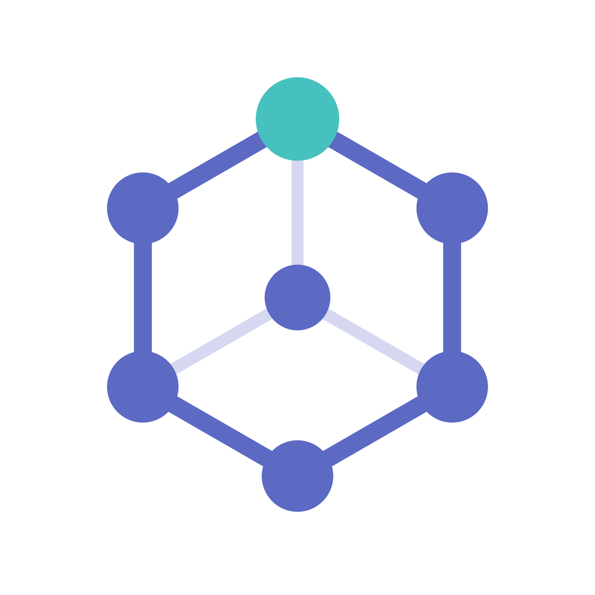
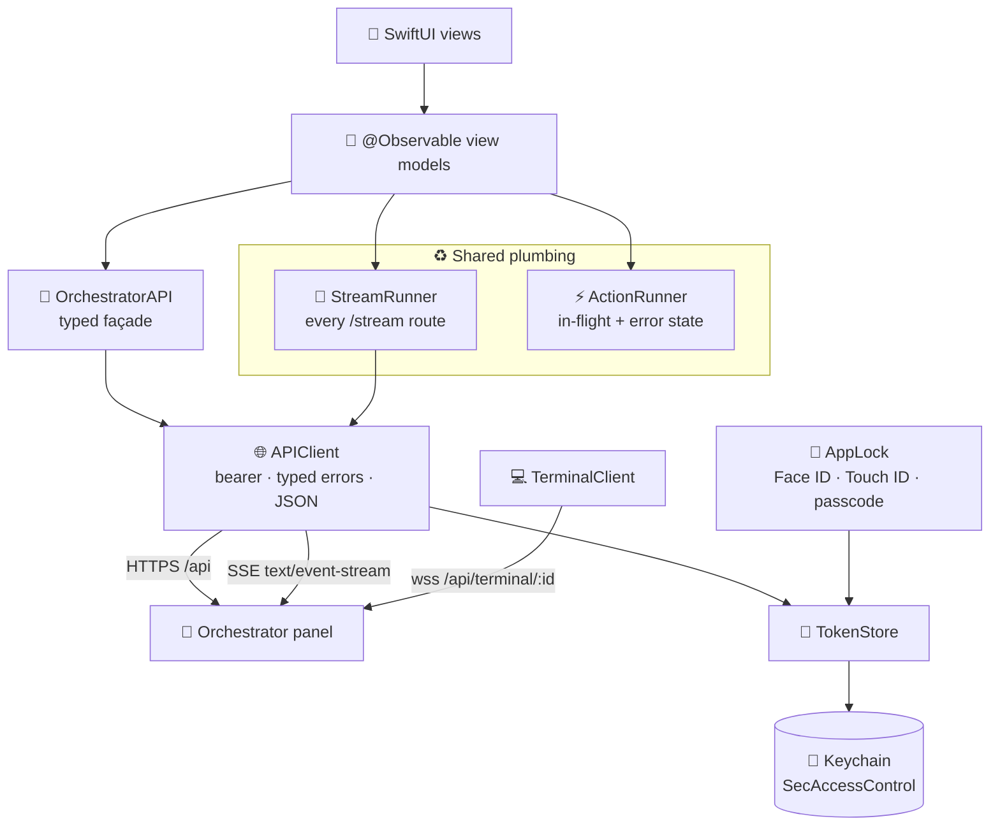

<div align="center">



# 📱 Orchestrator for iOS

### Native SwiftUI client for the [Orchestrator](https://github.com/thesaba/orchestrator) control panel

*Deploy, monitor, configure and bill your Laravel sites — from your pocket.*
*Every endpoint the panel exposes, with a live deploy log in your hand.*

<br/>

[](https://swift.org/)
[](https://developer.apple.com/xcode/swiftui/)
[](https://developer.apple.com/ios/)
[](https://developer.apple.com/xcode/)
[](#-tech-stack)
[](LICENSE)

<br/>

**🔗 Server side lives here → [thesaba/orchestrator](https://github.com/thesaba/orchestrator)**

</div>

---

## 📖 Table of Contents

- [✨ Overview](#-overview)
- [🎯 Features](#-features)
- [🏗️ Architecture](#️-architecture)
- [🧰 Tech Stack](#-tech-stack)
- [✅ Requirements](#-requirements)
- [⚡ Getting Started](#-getting-started)
- [🔒 Security](#-security)
- [📂 Project Structure](#-project-structure)
- [🔌 API Coverage](#-api-coverage)
- [🗺️ Roadmap](#️-roadmap)
- [🤝 Contributing](#-contributing)
- [📄 License](#-license)

---

## ✨ Overview

**Orchestrator for iOS** is a native SwiftUI front end for [**Orchestrator**](https://github.com/thesaba/orchestrator) — the self-hosted control panel that provisions, deploys and monitors PHP/Laravel sites on your own droplet.

It talks to the same REST API as the React dashboard and **changes nothing on the server**. Think of it as a second head on the same body: whatever the panel can do, the app can do — but with native navigation, Swift Charts, Face ID and a deploy log that streams straight to your phone.

> 💡 **Who is it for?** Anyone already running Orchestrator who wants to approve a deploy, check why a site went down, or mark an invoice paid without opening a laptop.

> ⚠️ This is a client for a **production** panel. Every action that changes server state sits behind a confirmation dialog that names the concrete consequence — "Every site is offline for the length of the reboot", not "Are you sure?".

---

## 🎯 Features

<table>
<tr>
<td width="50%" valign="top">

### 🚢 Deploy
- ⚡ **Live deploy log** streamed over SSE, with auto-reconnect
- 🔀 Deploy any `ref` — branch, tag or commit sha
- 🧪 Optional **skip-tests** toggle when the site has a test gate
- 👀 **Pending commits** — see what is about to ship before you ship it
- ⏪ **Releases & rollback** with a one-tap symlink swap
- 🔁 **Redeploy** any past deployment
- 🛑 Cancel a running deploy

### 📊 Monitoring
- 📈 CPU / RAM / disk / swap — live gauges + 24 h **Swift Charts** history
- 🩺 **Health score** per site with its uptime / deploy / SSL / maintenance breakdown
- ⏱️ **Uptime monitors** with per-site history and downtime markers
- 🔒 **Certificate expiry** across the fleet, soonest first
- 🚀 **Response times (p95)** ranked slowest-first
- 🔥 Top processes by CPU and memory
- 🐞 **Log intelligence** — grouped Laravel errors with counts and first/last seen
- 🔔 Notification inbox with swipe-to-read and mark-all

### 💰 Billing
- 💵 MRR, outstanding balance and **aging buckets**
- 🧾 Invoices with line items unpacked from the stored JSON
- 💳 **Record a payment** — full or partial, cash / bank / card, with reference
- 🚫 Void an invoice
- 🎚️ Enforcement switch (`off` / `dry_run` / `on`) with plain-language consequences
- 📉 Per-site **profitability**
- 💎 All money handled as integer minor units — never floats

</td>
<td width="50%" valign="top">

### ⚙️ Configuration
- ✏️ **.env, nginx and PHP-FPM editors** with per-file warnings
- 🕰️ **.env version history** — inspect and restore any prior version
- 🐘 Per-site **PHP version** switching
- 🔒 **SSL** issue / renew / remove with a live certbot log
- ⏰ Scheduler (cron) and public status page toggles
- 🛡️ **Per-site security** — HTTP basic auth + IP allow/deny lists

### 🗂️ Files & Data
- 📁 **File manager** — browse, rename, chmod, zip/unzip, multi-select delete
- 📝 In-app text editor for source and config files
- 💾 **Database backups** — create, restore, delete, push off-site to S3/R2
- 📅 Scheduled backups with an hour + weekday picker
- 🧪 **SQL console** — reads run straight through, writes need a second confirmation

### 🖥️ Infrastructure
- 🌐 **Multi-server** — health, connection test, and a streamed **Prepare** run
- 🌊 **DigitalOcean** — power, resize, snapshots, backups, rename
- 🧰 **System control** — apt, cleanup, ufw rules, all streamed live
- 🟢 Service control (nginx, MySQL, Redis, PHP-FPM…)
- 💻 **Interactive terminal** over WebSocket
- 👷 Workers, queue stats and failed-job retry/flush
- 🧙 **Artisan runner** with dangerous commands flagged in red

### 🧠 Productivity & Admin
- ✨ **AI assistant** chat, optionally grounded in a specific site
- 🗂️ Tasks with checklists and comments · 📝 Notes · 📅 Calendar
- 🔔 Threshold **alert rules**
- 🧾 Paginated **audit log**
- 👥 Users and **per-site access grants**
- 📨 Telegram linking and the weekly digest

</td>
</tr>
</table>

---

## 🏗️ Architecture



Three rules hold the layers apart:

1. **Views never build a URL.** `OrchestratorAPI` owns every path, so a route change is a one-line fix.
2. **Every `/stream` endpoint uses one driver.** Deploy, provision, SSL, Artisan, server prepare and system ops all speak the same `{ line }` / `{ done, status }` protocol, so `StreamRunner` handles reconnect and ANSI stripping once.
3. **No mutating call fails silently.** `ActionRunner` owns the in-flight flag and the error message; if a request fails, something on screen says so.

---

## 🧰 Tech Stack

| Layer | Technologies |
|-------|-------------|
| **UI** | SwiftUI · [Swift Charts](https://developer.apple.com/documentation/charts) · `@Observable` (Observation) |
| **Concurrency** | Swift Concurrency — `async`/`await`, `AsyncThrowingStream`, structured `async let` fan-out |
| **Networking** | `URLSession` · `URLSession.bytes` for SSE · `URLSessionWebSocketTask` for the terminal |
| **Persistence** | Keychain (`Security`) · `LocalAuthentication` for the app lock |
| **Coding** | `Codable` throughout, with a tolerant date parser and a lenient `JSONValue` for loosely shaped payloads |
| **Dependencies** | **None.** No SPM packages, no CocoaPods, no Carthage |

Unlike the browser's `EventSource`, `URLSession` can set an `Authorization` header on a streaming request — so SSE uses the bearer token directly instead of smuggling it through the query string.

---

## ✅ Requirements

- 🍎 **iOS 26.5+**
- 🛠️ **Xcode 26** on macOS 14.5+
- 🚀 A reachable [Orchestrator](https://github.com/thesaba/orchestrator) panel over **HTTPS** with a valid certificate
- 🔑 A **Personal Access Token** from the panel (Settings → API tokens), or an account with email/password

> The app is not distributed on the App Store. Build and install it on your own device with your own signing identity.

---

## ⚡ Getting Started

```bash
git clone https://github.com/thesaba/orchestrator-ios.git
cd orchestrator-ios
open Orchestrator.xcodeproj
```

**1️⃣ Point it at your panel**

Edit `Orchestrator/Core/APIConfig.swift`:

```swift
static let baseURL = URL(string: "https://panel.example.com")!
```

**2️⃣ Set your signing team**

Select the `Orchestrator` target → *Signing & Capabilities* → pick your team. The bundle identifier is `digital.abesadze.Orchestrator`; change it to your own.

**3️⃣ Build, run, and paste a token**

Generate a token in the panel under **Settings → API tokens** (it starts with `orch_`) and paste it on the sign-in screen. It goes straight into the Keychain and is never written anywhere else.

Prefer email and password? Tap **Sign in with email instead** — two-factor codes are supported.

**4️⃣ Optional: turn on the app lock**

**Settings → App lock** re-writes the stored token behind a biometric access-control rule. See [Security](#-security) for what that actually means.

---

## 🔒 Security

- 🔑 **Keychain only.** The bearer token never touches `UserDefaults`, never appears in a log line, and is excluded from the app's preference backups.
- 🙂 **The app lock is not a curtain.** When enabled, the token is stored with a `SecAccessControl` user-presence rule, so **iOS itself refuses to hand it over** without Face ID, Touch ID or the device passcode. Unlocking *is* the authenticated Keychain read — there is no "check biometrics, then read anyway" step to bypass. The app re-locks after a minute in the background.
- 🚪 **401 means sign out — except when it doesn't.** While the app is locked the token is deliberately absent, so requests are refused before they are even sent, and a locked state is never mistaken for an expired credential.
- ⚠️ **Confirmations name consequences.** Rollback warns that migrations are not reverted. A restore warns that everything written since the dump is lost. `ufw enable` warns you can lock yourself out. Destructive Artisan commands are flagged before the dialog appears.
- 🔍 **Read-only by default in the SQL console.** `SELECT` / `SHOW` / `EXPLAIN` run immediately; anything else requires a second confirmation that names the statement type.
- 🔐 **TLS only.** No App Transport Security exceptions, no self-signed certificate handling — the panel is expected to have a real certificate.

---

## 📂 Project Structure

```
orchestrator-ios/
├── Orchestrator/
│   ├── Core/                       # networking, auth, streaming
│   │   ├── APIClient.swift         # bearer, typed errors, SSE, downloads
│   │   ├── OrchestratorAPI*.swift  # typed façade, split by domain
│   │   ├── Keychain · TokenStore   # token storage + biometric sealing
│   │   ├── AppLock.swift           # Face ID / Touch ID / passcode gate
│   │   ├── StreamRunner.swift      # one driver for every /stream route
│   │   ├── ActionRunner.swift      # in-flight + error state for mutations
│   │   └── TerminalClient.swift    # WebSocket shell
│   ├── Models/                     # Codable models, one file per domain
│   ├── DesignSystem/               # status tones, cards, log console, logo
│   ├── Features/                   # one folder per screen area
│   │   ├── Overview · Sites · Monitor · Inbox · More
│   │   ├── Deploy · Artisan · Workers · Config · Files · Database
│   │   ├── Billing · Infrastructure · Workspace · Admin · Terminal
│   │   └── Auth/                   # sign-in and lock screens
│   └── Assets.xcassets/
├── tools/                          # API introspection helpers
└── Orchestrator.xcodeproj
```

---

## 🔌 API Coverage

Every endpoint the panel exposes has a typed method in `Core/OrchestratorAPI*.swift`.

| Domain | Covered |
|--------|---------|
| **Auth & account** | login (+ TOTP), `me`, 2FA setup/enable/disable, tokens, password change |
| **Sites** | list, detail, tags, health score, Laravel logs, security, status page |
| **Deploy** | trigger, cancel, pending, releases, rollback, redeploy, test stats, SSE log |
| **Config** | nginx, `.env` (+ versions & restore), PHP-FPM, PHP version, SSL (+ SSE), scheduler, cron |
| **Files** | list, read, write, mkdir, touch, delete, rename, copy, move, zip/unzip, tar/untar, chmod, chown, search, properties, download |
| **Database** | backups, restore, schedule, S3/R2, databases, SQL query |
| **Laravel ops** | Artisan (+ SSE), supervisor, queue stats, failed jobs |
| **Monitoring** | system, history, processes, APM, services (+ control), SSL, uptime, alerts, log errors |
| **Billing** | overview, enforcement, clients, subscriptions, invoices, payments, profitability |
| **Infrastructure** | servers (+ prepare SSE), DigitalOcean droplet, system ops (SSE), terminal (WebSocket) |
| **Workspace** | tasks (+ checklist & comments), notes, calendar, AI assistant, Telegram, digest, audit, users |

> Request and response shapes were verified against the panel's own client rather than guessed — which is how the app knows that `deploy` takes `?ref` and `?skipTests` as **query parameters**, that `maintenance` wants `{ action }`, and that invoice payments are the one place where an amount travels as a decimal string in major units.

---

## 🗺️ Roadmap

- [ ] 🧪 Unit tests for decoding, date parsing and the lock state machine
- [ ] 🖼️ Full terminal emulation (the current console strips ANSI rather than interpreting it)
- [ ] ➕ Site creation, cloning and provisioning from the app
- [ ] 🔔 Push notifications for failed deploys and downtime
- [ ] 🙂 Optional re-authentication before individual destructive actions
- [ ] 📱 iPad-optimised split layouts
- [ ] ⌚️ Widgets and a Lock Screen deploy-status complication

---

## 🤝 Contributing

Contributions are welcome! 🎉

1. 🍴 Fork the repository
2. 🌱 Create a feature branch — `git checkout -b feat/amazing-thing`
3. ✅ Commit your changes — `git commit -m "feat: add amazing thing"`
4. 🚀 Push and open a Pull Request

Before submitting, make sure the project builds cleanly:

```bash
xcodebuild -project Orchestrator.xcodeproj \
           -scheme Orchestrator \
           -destination 'platform=iOS Simulator,name=iPhone 17 Pro' \
           build
```

Please keep PRs focused and follow the existing structure — new endpoints belong in the matching `OrchestratorAPI+*.swift` extension, and any action that changes server state needs a confirmation dialog that spells out what it does.

---

## 📄 License

Distributed under the **MIT License** — see [`LICENSE`](LICENSE) for details.

Copyright © 2026 [**@thesaba**](https://github.com/thesaba).

---

<div align="center">

**🚀 Powered by [Orchestrator](https://github.com/thesaba/orchestrator) — the self-hosted panel this app talks to.**

**⭐ If it saves you a trip to the laptop, consider starring both repos! ⭐**

Made with ❤️ and Swift

</div>
